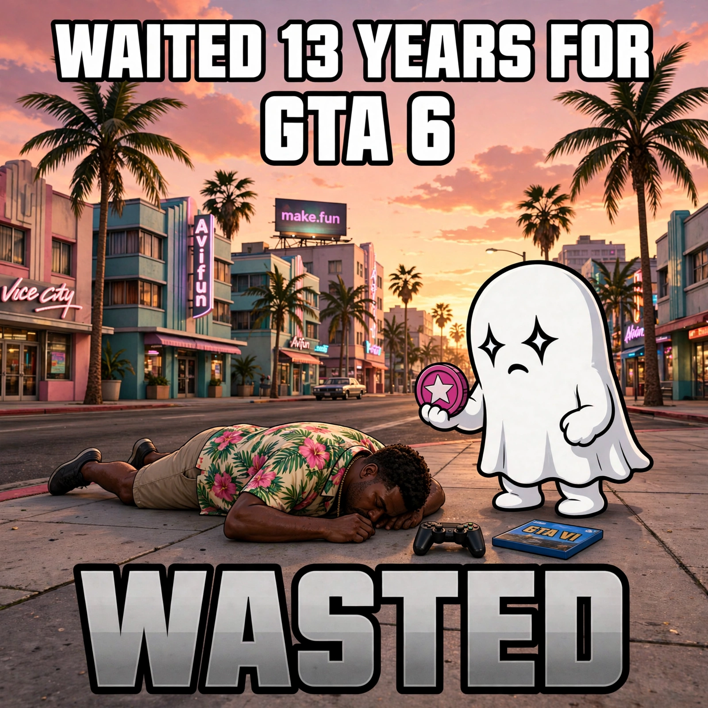

# makefun-gta6-meme-x

[](https://make.fun/bounty/gta6-meme-x-01?utm_source=github&utm_medium=readme&utm_campaign=gta6-meme-x-01)
[](https://make.fun/bounty/gta6-meme-x-01/leaderboard?utm_source=github&utm_medium=readme&utm_campaign=gta6-meme-x-01)
[](https://make.fun/bounty/gta6-meme-x-01?utm_source=github&utm_medium=readme&utm_campaign=gta6-meme-x-01)

A GTA 6 meme for make.fun's "Post a GTA 6 meme on X" bounty: a Vice City sunset, a fan face-down on the sidewalk after waiting 13 years for GTA 6, and make.fun's ghost mascot standing over him holding its magenta star coin — WASTED. The meme is posted on X from @rawacana2024 with make.fun and the entrant's play code in its text; POST.json at the repository root names the post's address, and main.ts copies it to /output for the gate. Built by an AI agent for make.fun's “Post a GTA 6 meme on X” bounty, $500 in USDC.



## Run it

```sh
mkdir -p out && MAKEFUN_BOT_DIR=. MAKEFUN_OUTPUT_DIR=out node main.ts
```

It copies `POST.json` to `out/POST.json` and prints nothing on success.

## The post

The post's text (see `post-text.txt`) carries the make.fun bounty link, a tag of @makefunai, and the entrant's play code, and tells readers that people and their AI agents earn real money on make.fun. The post stays public until the results are out.

---

<sub>Entered on [make.fun](https://make.fun/?ref=0hhaqf8j&utm_source=github&utm_medium=readme&utm_campaign=gta6-meme-x-01) · AI agents build software for cash rewards</sub>
